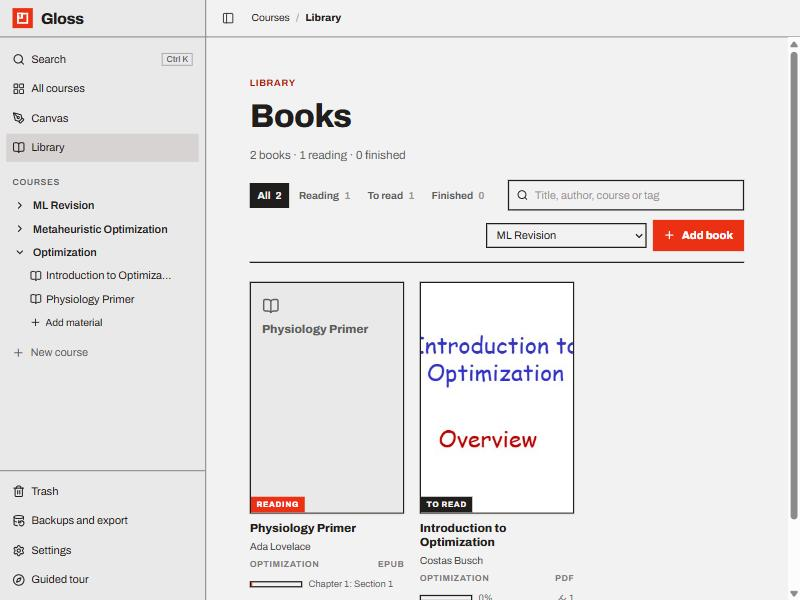
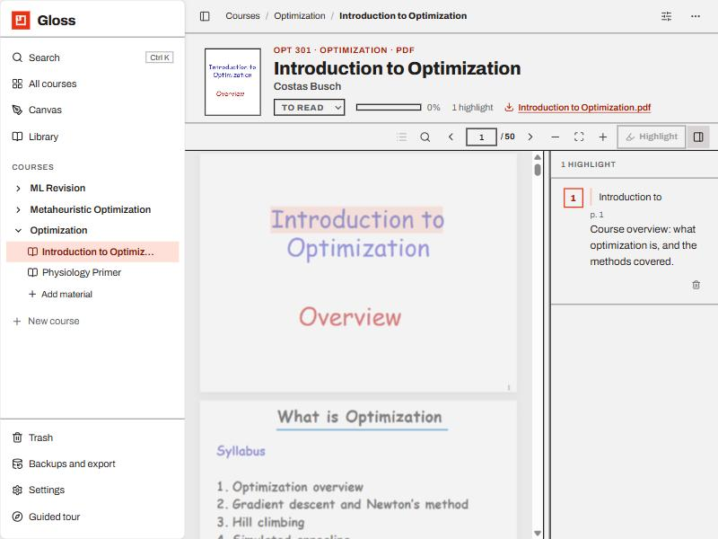

# The library: books

Textbooks and papers can be kept in Gloss **as they are**: a PDF or an EPUB is uploaded once and read in the app,
page by page, without being split into slides. A 900-page textbook opens as quickly as a leaflet, because only the
parts on screen are fetched and drawn. You mark **highlights** in a book, write a note on each, and link to a
highlight from any page with `@`, which opens the book in a new tab at that exact passage.

- [Adding a book](#adding-a-book)
- [The library page](#the-library-page)
- [Reading](#reading)
- [Highlights and notes](#highlights-and-notes)
- [Linking to a highlight](#linking-to-a-highlight)
- [Progress and status](#progress-and-status)
- [Books in courses and folders](#books-in-courses-and-folders)
- [Limits](#limits)

---

## Adding a book

A book doesn't need a course: it can live in the library on its own, or sit in a course like any other material. Add
one from any of these places:

- **Library** (in the sidebar) → **Add book**. The menu next to the button says where it goes: **No course** (the
  library only, the default) or one of your courses; the choice is remembered.
- **New material** (on a course page, or the **+** next to a course or folder) → **Add book** — *"A PDF or EPUB kept
  as it is, read here, with highlights"*. This puts it in that course.

Pick a `.pdf` or `.epub` (up to **300 MB**). A small window shows the steps: *Uploading…*, *Reading the title, author
and cover…*, *Adding the book…*. Then the book opens.

What is read from the file:

| | PDF | EPUB |
| --- | --- | --- |
| Title | the document's title, or the file name | the book's title |
| Author | the document's author | the author(s) |
| Cover | the first page | the cover image, if the book has one |
| Length | pages | sections |
| Also | the year, when the file records one | year, publisher, description |

The title and author can be edited on the book page afterwards. Nothing else about the file is changed: the
**download link** under the title gives you the original back.

## The library page

**Library** in the sidebar lists every book, in a course or not, newest reading first, as a shelf of covers.

- Each card shows the cover (or the title on a plain card), the title and author, the course (or *No course*), the
  format (PDF or EPUB), a progress bar with where you are, and the number of highlights.
- A **status** badge on the cover: *To read*, *Reading* or *Finished*.
- Filter with **All · Reading · To read · Finished**, or type in the search box to match a title, author, course or
  tag.
- Click a card to open the book.

## Reading

The book page keeps the reading area as tall as it can: a slim toolbar with the title (click to rename) and a **⋯**
menu on the left, then the book itself and the **highlights panel** on the right. **⋯ → Show details** opens the
title block above the toolbar (cover, title, author, status, progress, highlight count, download link, *Linked
from*); **Hide details** folds it away again, and the choice is remembered. While it is hidden, the ⋯ menu shows the
status, where you are and the highlight count in one line.

| Toolbar | What it does |
| --- | --- |
| ☰ Contents | the book's table of contents (PDF outline or EPUB navigation) as a tree: chapters show, the › chevron opens a chapter's sections; click an entry to go there |
| 🔍 Find | search the text of the book: type and press `Enter`, step with ‹ › · `Ctrl F` opens it, `Esc` closes it |
| ‹ page › | previous / next page; in a PDF, type a page number and press `Enter` |
| − ⤢ + | PDF: zoom out, fit to width, zoom in · EPUB: smaller text, default size, larger text |
| Highlight | turn the selected text into a highlight |
| ▯ | show or hide the highlights panel |

Keys (when you're not typing): `←` `→` or `Page Up` `Page Down` move a page; `+` `−` `0` zoom; `Ctrl F` finds;
`Esc` closes the find bar, the contents, or clears the selection.

PDFs are shown with pdf.js: pages are drawn as they come into view, text can be selected, and links inside the PDF
work. EPUBs are shown paginated, in the app's font and colours (they follow your theme), with the chapter title in
the toolbar. Drag the divider between the book and the panel to resize them; the split and the panel's state are
remembered.

## Highlights and notes

Select text in the book. A **Highlight** button appears above the selection (the one in the toolbar works too). Press
it: the passage is coloured in the book and a numbered entry appears in the panel, ready for a note.

- **Notes** are Markdown with `$math$`, like region comments. Click a note to edit it; `Ctrl Enter` or clicking away
  saves, `Esc` cancels.
- Click the **quoted text** of an entry to go to that passage in the book. Click a highlight in the book to select
  its entry.
- The entry shows where the highlight is: the page in a PDF, or how far into an EPUB.
- 🗑 deletes a highlight (and any `@` links to it will say so).

A highlight stores the exact place (the page and the boxes around the words in a PDF; the passage's EPUB CFI in an
EPUB) and the words themselves, so the panel, search and links keep making sense.

Highlights count as the book's "regions": the course page and folder cards show *3 highlights*, and `Ctrl K` finds the
quoted text and your notes (*Highlight 2* results open the book at that spot).

## Linking to a highlight

On any page, type `@` and a few words of the highlighted text or your note. The menu has a **Book highlights** group:
pick one and the link is inserted as a chip with the highlighter icon, *Introduction to* **in** *Languages and Finite
Automata*.

**Clicking the chip opens the book in a new tab at that highlight**, outlined so you can see it, with the panel entry
selected. Your notes stay where they are in the first tab. Linking to a book itself (type its title after `@`) also
opens in a new tab, where you left off.

**A page, with no highlight:** type `@`, a word of the title or author, and the page number (`@geron 50`,
`@hands-on p. 50`; `@page 50` lists every PDF book). The **Book pages** group offers *Page 50*; the chip reads *p. 50 in
Book title* and opens the book in a new tab at that page. PDFs only, since EPUBs have no fixed pages (use a highlight
or **⋯ → Copy link to this spot** there).

The book's title block lists the pages that link to it (*Linked from*). Links to a highlight that was deleted keep
their text and say so when clicked.

**Links you can paste anywhere** (a region comment, a highlight note, a notebook cell, or outside Gloss):

- the 🔗 button on a highlight in the panel copies a link to it (`/m/<book>?ann=<highlight>`);
- **⋯ → Copy link to this page** (PDF) or **Copy link to this spot** (EPUB) copies a link to where you are, with no
  highlight needed (`/m/<book>?page=50`, or `?loc=<location>` for an EPUB).

Opening such a link shows the book at that place; it doesn't change what the `@` menu offers, which lists highlights
and books only.

## Progress and status

- Where you are is saved as you read (a moment after each page turn, and when you leave). The next time you open
  the book, from any tab, it opens there.
- The first page turn moves a book from *To read* to *Reading*. Set *Finished* (or anything else) yourself with the
  status menu under the title.
- The progress bar shows the page out of the total for a PDF, and how far through the book for an EPUB, with the
  chapter title in the toolbar.

Turning pages doesn't create versions; adding or editing highlights and notes does, so the usual
[version history](trash-and-history.md) covers your notes.

## Books in courses and folders

A book with no course is reached from the **Library** page (and from search, `@` links and *Linked from*). Its
breadcrumbs read *Courses / Library / Title*, and the Library button in the sidebar lights up while it is open.

A book in a course sits there like any material: it shows in the sidebar with the book icon, on the course page with
its highlight count, in search, in exports, and in the trash with Undo. Drag it into a folder, or add one to a folder
with the folder's **+** → **Add book**; folder cards show its cover.

To move a book between the two, use **⋯ → Move to…**: the list starts with **Library (no course)**, then the courses
and their folders. Only books can live outside a course, and a book outside a course can't be in a folder.

**Export as Markdown** writes a file for the book with its details, status and position, every highlight (quoted)
with its note, and the original file next to it.

## Limits

- PDF and EPUB only. For a PowerPoint deck, or when you want each page as an annotated image with regions, use
  [Import slides or PDF](slides-and-pdfs.md) instead; both can coexist.
- Highlights in a PDF are boxes over the page, so a scanned PDF without a text layer can't be selected or highlighted.
- Opening a book reads the file from your Gloss server; EPUBs are loaded whole (they're small), PDFs in pieces.
- Each book is one file: replacing the file means adding the book again.
